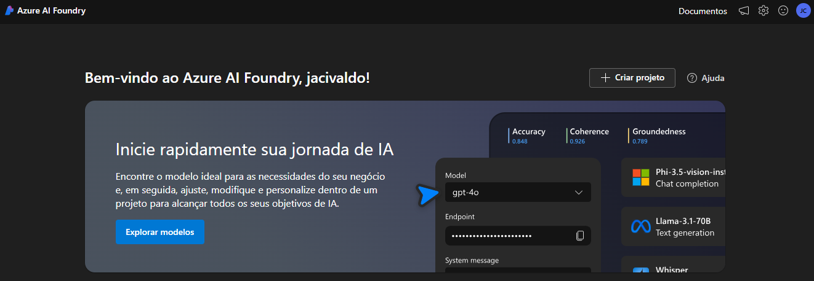
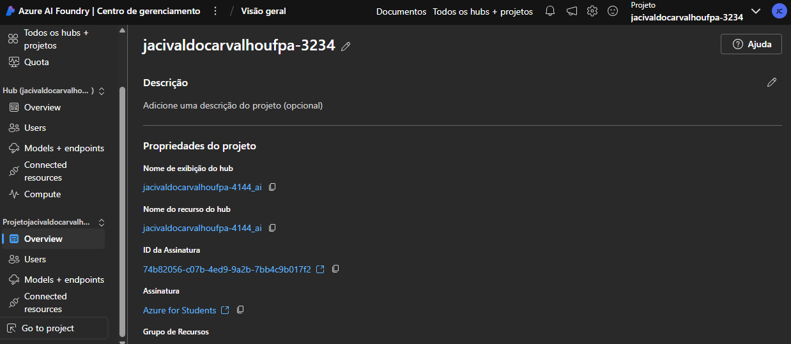
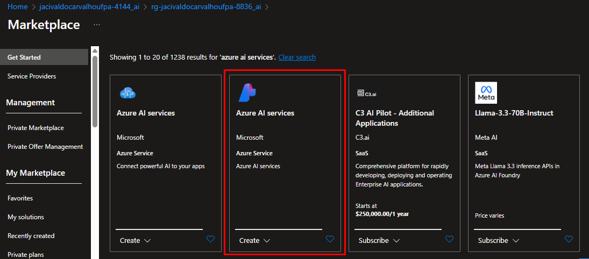
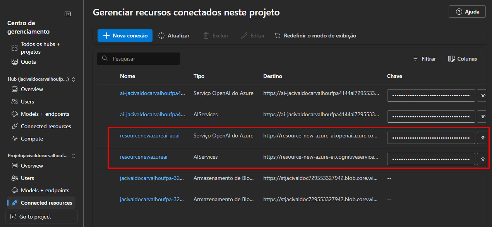
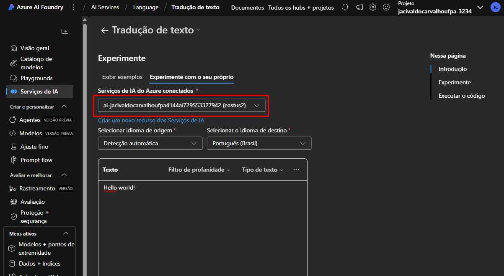
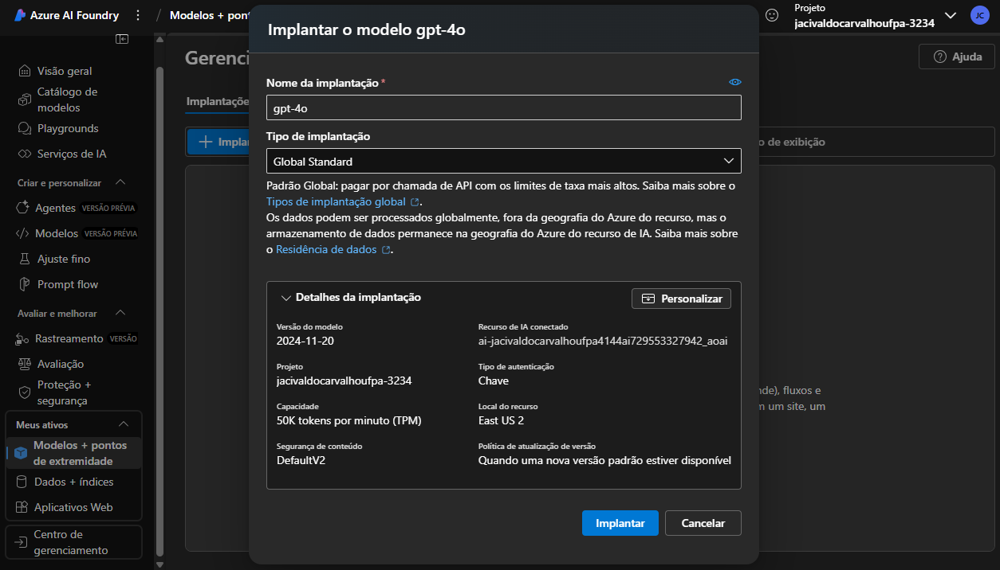
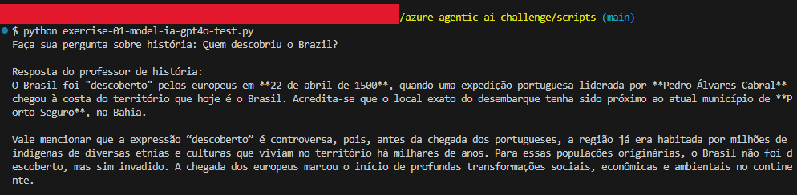

# Prepare an AI development project with Azure AI Foundry

> Study notes from the 2025 challenge. See the [documentation scope and compatibility notes](../README.md#scope-and-compatibility) before following portal instructions or SDK examples.

## Contents

- [Objective and prerequisites](#objective-and-prerequisites)
- [Open the portal](#open-the-portal)
- [Create a hub and project](#create-a-hub-and-project)
- [Add connected resources](#add-connected-resources)
- [Explore an AI service](#explore-an-ai-service)
- [Deploy a generative model](#deploy-a-generative-model)
- [Test the local Python example](#test-the-local-python-example)
- [Cleanup and outcome](#cleanup-and-outcome)
- [Original learning references](#original-learning-references)

## Objective and prerequisites

Explore a hub-based Azure AI Foundry project, connect AI services, and test a deployed model. You need an Azure subscription, permissions to create the lab resources, and access to a compatible model deployment. Resource creation and model use may incur charges.

The portal sequence and screenshots below record the 2025 exercise. For the maintained local Python example, follow the [root README](../../README.md#run-the-python-example).

## Open the portal

Sign in to the [Azure AI Foundry portal](https://ai.azure.com). In the original interface, dismiss introductory panels and open the project or management experience.



## Create a hub and project

Create a project and a hub dedicated to the lab. Choose the subscription, resource group, and region deliberately; the required model and capacity must be available in that environment. The hub organizes shared resources, while the project holds the work for this exercise.



## Add connected resources

The original walkthrough created an Azure AI Services resource through the Azure portal and connected it to the project. Use the resource's supported connection mechanism and verify permissions before testing a service.



Return to the management center and review connected resources.



## Explore an AI service

The course used the language and translation experience to translate “Hello World!” into other languages. Locate the supported translation experience for your resource and inspect its inputs and outputs.



## Deploy a generative model

The original lab selected GPT-4o from the model deployment experience. The repository script expects a deployment named `gpt-4o`, API version `2024-12-01-preview`, and support for the request parameters described in the root README. Verify compatibility before using that script; the screenshot is not proof of current model availability.



## Test the local Python example

The repository maintains one executable version of the history assistant:

```bash
python exercises/01-history-assistant.py
```

Run it from the repository root after completing the virtual environment and `.env` setup in the [installation instructions](../../README.md#install-dependencies). This replaces the duplicated inline script from the original guide so configuration and error handling have a single maintained implementation.

The example validates required configuration, accepts one question, sends it to the deployment, and prints the answer. Terminal messages are in English; the original history-teacher system prompt remains in Portuguese. The live model request requires credentials and may incur charges.



The screenshot shows the original execution and may differ from the current terminal messages.

## Cleanup and outcome

You have explored resource organization, a connected AI service, and model deployment. Stop or remove resources created only for the exercise when finished. Before deleting a resource group, confirm that it contains no shared resources or data you need to keep. The local Python script does not provision or delete Azure resources.

## Original learning references

- [01 explore ai studio](https://microsoftlearning.github.io/mslearn-ai-studio/Instructions/01-Explore-ai-studio.html)
